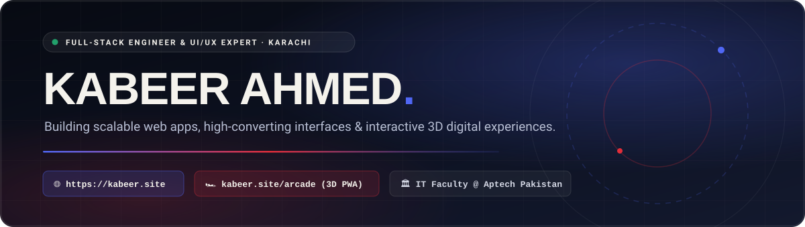

 

---

### ⚡ Behind the Code

Hey, I'm **Kabeer Ahmed** — a **Full-Stack Engineer & UI/UX Specialist** based in **Karachi, Pakistan**. I architect fast, scalable web applications and craft interactive digital experiences where reliable backend engineering meets a sharp editorial design point of view.

- 🏛️ **Current Role**: **IT Faculty & Full-Stack Web Development Instructor** at **Aptech Pakistan** — mentoring aspiring engineers in modern full-stack architecture while shipping production client systems.
- 🌐 **Interactive Portfolio**: Explore my selected works, 3D WebGL experiences, and case studies at **[kabeer.site](https://kabeer.site/)**.
- 🏎️ **Offline-First Web Engineering**: Creator of **[Asphalt Overdrive 3D](https://kabeer.site/arcade/)** ([Source Repo](https://github.com/Kabeer099/kabeer-arcade)) — a 60FPS 3D highway traffic racer built with vanilla HTML5 Canvas, Web Audio V8 synthesis, and a Service Worker that runs **100% offline** after a single visit.
- 📫 **Direct Contact**: **[kabeer.ahmed0120@gmail.com](mailto:kabeer.ahmed0120@gmail.com)**

---

### 🛠️ Tech Arsenal & Engineering Stack

**Frontend & Interactive UI/UX**

  
  
  
  
  
  
  
  

**Backend, APIs & Databases**

  
  
  
  
  
  

**Design, Tooling & Deployment**

  
  
  
  

---

### 🚀 Featured Production Projects & Experiments

| Project | Architecture & Highlights | Live Experience |
| :--- | :--- | :--- |
| **🌐 Kabeer.site — Official Portfolio** | Editorial design system, interactive 3D WebGL shaders, smooth GSAP page transitions & technical case studies. | **[Visit kabeer.site →](https://kabeer.site/)** |
| **🏎️ Asphalt Overdrive 3D (Offline PWA)** | 3D perspective highway racer with dynamic weather (*Alpine Day, Canyon Sunset, Wet Monsoon*), garage tuning & 100% offline Service Worker cache. | **[Play Game →](https://kabeer.site/arcade/)** · **[Source →](https://github.com/Kabeer099/kabeer-arcade)** |
| **🏋️ Platinum Fitness** | High-converting fitness platform showcasing advanced training programs, equipment catalogs & membership flows. | **[Case Study →](https://kabeer.site/portfolio-platinum.html)** |
| **🎓 PF Institute & PF Develop** | Full-stack educational certification portal and software development agency showcase. | **[Case Study →](https://kabeer.site/portfolio-pfinstitute.html)** |
| **⚡ Interac8 & Susheel KNS Systems** | Interactive digital solutions and corporate enterprise web architecture. | **[Case Study →](https://kabeer.site/portfolio-interac8.html)** |

---

  Crafted with precision by <a href="https://kabeer.site/"><strong>Kabeer Ahmed</strong></a> · <a href="https://www.linkedin.com/in/kabeerahmed-dev">LinkedIn</a> · <a href="https://kabeer.site/arcade/">Play Asphalt Overdrive 3D</a>

